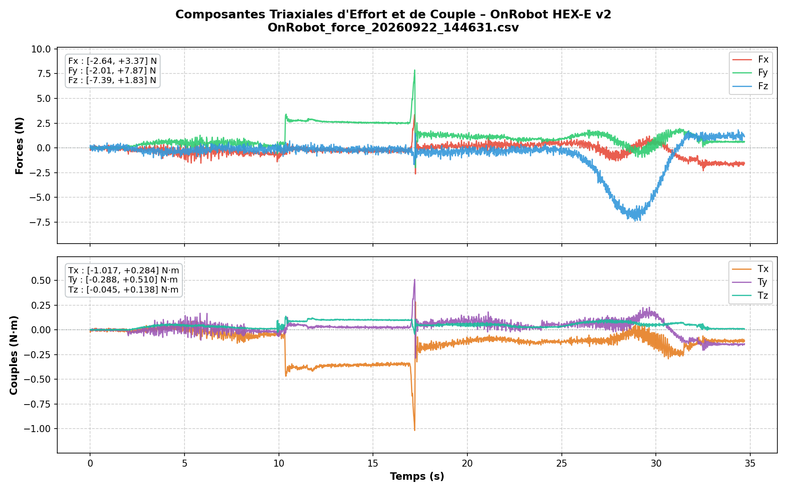
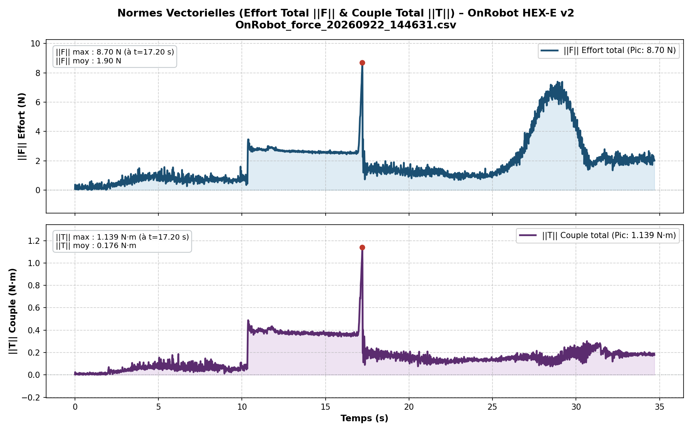
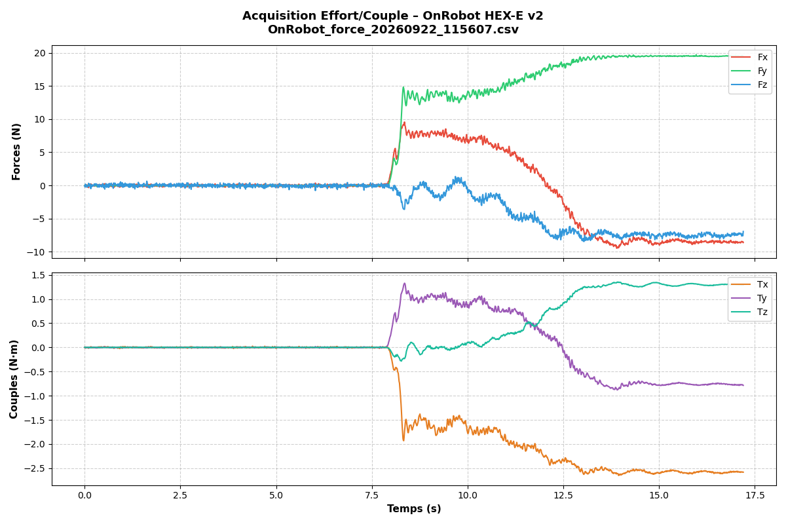
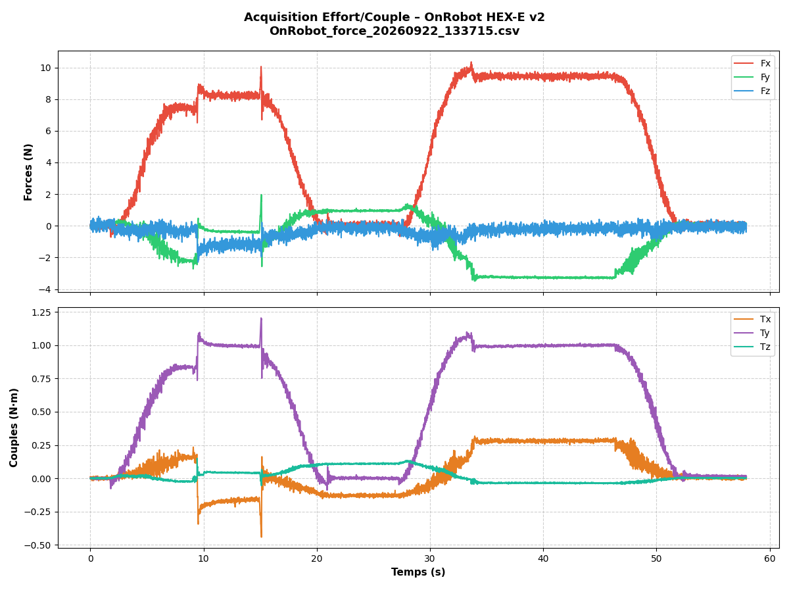
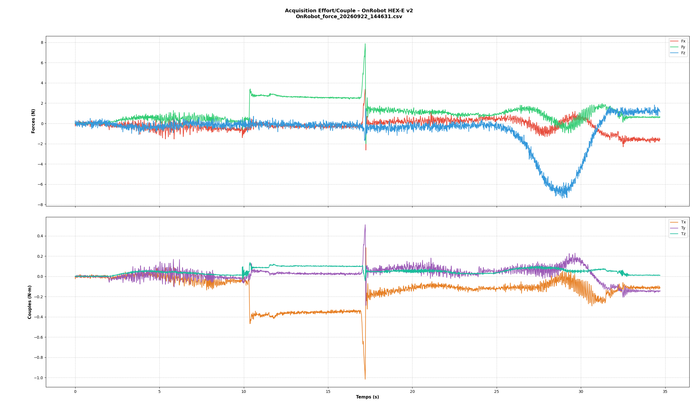

<!-- 
==============================================================================
Author: Kamil BENMADI
Email: kamil.benmadi@sigma-clermont.fr
GitHub: https://github.com/1000K-sudo
LinkedIn: https://www.linkedin.com/in/kamilb-
==============================================================================
-->

# UR5e + Tesollo DG-5F + OnRobot HEX-E v2 Manipulation Cell 🦾🖐️📈

Complete ROS 2 and low-level hardware integration workspace for the **Universal Robots UR5e** 6-DoF robotic arm equipped with the **Tesollo Delto Gripper DG-5F-R** (20-DoF anthropomorphic 5-finger dexterous hand with **Xela uSkin** tactile sensing) and the **OnRobot HEX-E v2** 6-axis Force/Torque sensor over raw EtherCAT.

---

## Table of Contents

1. [Overview & Key Contributions](#overview--key-contributions)
2. [Convenience Script `ur5e_cell.sh`](#convenience-script-ur5e_cellsh)
3. [Workspace Architecture](#workspace-architecture)
4. [3D Assets, URDF/Xacro & CAD Models Included](#3d-assets-urdfxacro--cad-models-included)
5. [Hardware & Network Architecture](#hardware--network-architecture)
6. [Tesollo DG-5F 20-DoF Control & Collision-Free Postures](#tesollo-dg-5f-20-dof-control--collision-free-postures)
7. [Coordinated UR5e + Tesollo Motion Control](#coordinated-ur5e--tesollo-motion-control)
8. [OnRobot HEX-E v2 EtherCAT Acquisition & Experimental Results](#onrobot-hex-e-v2-ethercat-acquisition--experimental-results)
9. [Unit & Integration Test Suite](#unit--integration-test-suite)
10. [Detailed Technical Guides & Manuals](#detailed-technical-guides--manuals)
11. [Related Repositories](#related-repositories)

---

## Overview & Key Contributions

This repository documents and provides all software modules, 3D kinematic/CAD assets, hardware drivers, and experimental datasets developed for the **UR5e + Tesollo DG-5F + OnRobot HEX-E v2** manipulation cell:

| Subsystem | Hardware / Protocol | Included Software & Assets |
| :--- | :--- | :--- |
| **Robotic Arm** | **Universal Robots UR5e** (6-DoF, RTDE TCP/IP `192.168.3.101`) | Full 3D meshes (`Universal_Robots_ROS2_Description`), unified cell Xacro (`ur5e_tesollo.urdf.xacro`), trajectory orchestration (`test_combined_motion.py`) |
| **Dexterous Hand** | **Tesollo DG-5F-R** (5 fingers, **20 independent DoF**, Modbus TCP `169.254.186.72:502`) | Official ROS 2 suite (`delto_m_ros2`), Gazebo Harmonic & Isaac Sim USD assets, C++ CLI (`tesollo_cmd.cpp`), Python `ctypes` SDK manager (`tesollo_20dof_manager.py`), live `/joint_states` broadcaster (`tesollo_joint_state_broadcaster.py`), certified collision-free 20-DoF pose library (`hand_poses_20dof.json`) |
| **Tactile Sensing** | **Xela uSkin** 3-axis magnetic taxels (VSCOM USB-CAN `slcan0` @ 1 Mbps) | ROS 2 driver (`xela_server_ros2`), 3D taxel URDF & STL meshes (`xela_description`, `xela_models`), full 3D STEP/STL CAD models for DG-5F palm & phalanges (`cad_assets/xela_uskin_cad/`) |
| **6-Axis F/T Sensor** | **OnRobot HEX-E v2** (Raw Layer-2 EtherCAT CoE `0x88A4` on dedicated NIC) | Standalone 100 Hz `pysoem` EtherCAT master (`test_onrobot_ft.py`), 56-byte TxPDO parser, automatic 100-sample software tare, triaxial + Euclidean norm ($\|\mathbf{F}\|$, $\|\mathbf{T}\|$) plotter (`plot_onrobot_ft.py`), unit test suite (`test_norms_and_plots.py`), and 10 recorded experimental datasets |

---

## Convenience Script `ur5e_cell.sh`

A unified bash management script at the root of the repository centralizes compilation, hardware bringup, 20-DoF posture execution, F/T acquisition, plotting, and automated testing:

```bash
# Build & Verification
./ur5e_cell.sh build                        # Install DGSDK, compile C++ tools (tesollo_cmd) & colcon build ROS 2 packages
./ur5e_cell.sh test                         # Run automated unit & integration tests (F/T norms, PDO parser, CSV/NPY export)
./ur5e_cell.sh status                       # Display workspace, network endpoints, SDK & dataset status

# Multi-Terminal Cell Orchestration
./ur5e_cell.sh start                        # Launch UR5e ROS 2 driver + RViz2 + Tesollo/Xela + 20-DoF TF broadcaster
./ur5e_cell.sh start --with-sensor          # Same as above + live 100 Hz OnRobot HEX-E v2 EtherCAT acquisition
./ur5e_cell.sh stop                         # Cleanly stop all nodes, drivers, and CAN/EtherCAT interfaces

# Modular Launchers
./ur5e_cell.sh ur5e                         # Launch UR5e ROS 2 driver and RViz2 standalone
./ur5e_cell.sh hand_rsp                     # Launch Tesollo DG-5F Robot State Publisher & static TF (tool0 -> right_base_link)
./ur5e_cell.sh hand_broadcaster             # Broadcast live 20-DoF hardware encoder angles to /joint_states

# Dexterous Manipulation & Force/Torque Sensing
./ur5e_cell.sh poses --list                 # List all certified collision-free 20-DoF hand postures
./ur5e_cell.sh poses DG_Pince_Fine_Pouce_Index --duration 2.5
./ur5e_cell.sh combined_test                # Execute safe synchronized UR5e wrist + Tesollo 5-finger motion test
./ur5e_cell.sh ft_acquire --format all      # Start 100 Hz EtherCAT CoE acquisition & software tare on OnRobot HEX-E v2
./ur5e_cell.sh ft_plot --latest             # Plot triaxial Forces/Torques and Euclidean norms (||F||, ||T||)
```

---

## Workspace Architecture

```text
ur5e_tesollo_ws/
├── README.md                              ← Main technical documentation
├── ur5e_cell.sh                           ← ✨ Unified CLI management script
├── docs/
│   ├── HARDWARE_SETUP.md                  ← Mechanical stack (ISO-50), electrical wiring & dual-NIC network setup
│   ├── TESOLLO_20DOF_POSE_GUIDE.md        ← Anti-collision 20-DoF pose design, extraction & ROS 2 replay
│   ├── COMBINED_MOTION_PROCEDURE.md       ← Step-by-step coordinated UR5e + Tesollo + OnRobot F/T procedure
│   ├── TESOLLO_SDK_SETUP.md               ← DGSDK v1.6.0 & Xela uSkin CAN setup guide
│   ├── manuals/                           ← Official hardware PDFs & DH kinematic parameter sheets
│   └── figures/                           ← Experimental Force/Torque plots & analysis figures (.png)
├── scripts/
│   ├── start_cellule.sh                   ← Multi-terminal cell launcher (UR5e + Tesollo/Xela + optional OnRobot F/T)
│   ├── stop_cellule.sh                    ← Clean shutdown of all cell nodes and CAN/EtherCAT interfaces
│   ├── run_hand.sh                        ← Tesollo DG-5F + Xela uSkin CAN (slcan0) initialization
│   ├── run_xela.sh                        ← Standalone Xela tactile sensor suite launcher
│   ├── tesollo_20dof_manager.py           ← 20-DoF pose manager (ctypes libDGSDK.so + ROS 2 publisher)
│   ├── tesollo_joint_state_broadcaster.py ← Real-time 20-DoF hardware encoder broadcaster to /joint_states
│   ├── send_hand_pose_ros2.py             ← Standalone 20-DoF certified pose sender (SDK & ROS 2)
│   ├── test_combined_motion.py            ← Safe synchronized UR5e wrist + Tesollo 5-finger motion test
│   ├── test_onrobot_ft.py                 ← Real-time 100 Hz EtherCAT CoE acquisition & software tare (pysoem)
│   ├── plot_onrobot_ft.py                 ← Triaxial force/torque & Euclidean vector norm (||F||, ||T||) plotter
│   └── test_norms_and_plots.py            ← Automated unit & integration test suite
├── sdk_tools/
│   ├── tesollo_cmd.cpp                    ← High-speed C++ CLI controller for Tesollo DG-5F (DGSDK)
│   ├── CMakeLists.txt                     ← CMake build configuration for C++ SDK tools
│   ├── install_sdk.sh                     ← Global installer for libDGSDK.so and headers
│   ├── install_dependencies.sh            ← Auto-detecting Ubuntu 22.04 / 24.04 dependency installer
│   ├── DGSDK/                             ← Official DGSDK v1.6.0 headers (DGSDK.h, DGDataTypes.h) & libDGSDK.so
│   ├── kinematics/                        ← Official DG-5F Left/Right Forward & Inverse Kinematics C++ code
│   └── xela_config/                       ← Xela uSkin tactile configuration (DG-5F-R.xela, xServ.ini)
├── config/
│   ├── hand_poses_20dof.json              ← Certified collision-free 20-DoF hand postures catalog
│   ├── hand_poses.json                    ← Finger flexion presets
│   ├── poses_presets.json                 ← Joint & Cartesian preset configurations
│   ├── sequences.json                     ← Coordinated motion sequences
│   └── GripperRecipeData.json             ← Exported DGManager operator recipes
├── launch/
│   └── dg5f_rsp.launch.py                 ← Robot State Publisher + static TF (tool0 -> right_base_link)
├── urdf/
│   ├── ur5e_tesollo.urdf.xacro            ← Complete assembled cell Xacro (UR5e + OnRobot HEX-E v2 + Tesollo DG-5F)
│   └── ur5e_tesollo_view.rviz             ← Preconfigured RViz2 3D visualization layout
├── cad_assets/
│   ├── xela_uskin_cad/                    ← 3D CAD STEP (.stp) & STL models for DG-5F uSkin palm, phalanges & patches
│   └── dgmanager_3d_assets/               ← Standalone 3D visual/collision meshes & URDFs for all Delto grippers
├── data/
│   └── onrobot_ft_recordings/             ← 10 experimental F/T sessions organized in dedicated subfolders
│       ├── README.md                      ← Complete session index table & visual gallery
│       └── OnRobot_force_<YYYYMMDD_HHMMSS>/
│           ├── OnRobot_force_<...>.csv    ← 20-column CSV time series (tared & raw + norms)
│           ├── OnRobot_force_<...>.npy    ← Binary float64 NumPy matrix
│           ├── OnRobot_force_<...>.txt    ← Tab-separated text log
│           ├── OnRobot_force_<...>_3axes.png ← Triaxial Force/Torque + Norm curves
│           ├── OnRobot_force_<...>_norme.png ← Euclidean Force/Torque Norm curves
│           └── OnRobot_force_<...>.png    ← Combined overview plot
└── src/                                   ← ROS 2 Packages & 3D Description Packages
    ├── delto_m_ros2/                      ← Complete Tesollo ROS 2 suite
    │   ├── dg_description/                ← 3D visual (.dae) & collision (.stl) meshes (DG-3F, DG-4F, DG-5F L/R)
    │   ├── dg5f_driver/                   ← ROS 2 control launch files, YAML controllers & JTC scripts
    │   ├── dg5f_gz/                       ← Gazebo Harmonic simulation package & configs
    │   ├── delto_hardware/                ← ros2_control SystemInterface C++ plugin
    │   ├── delto_tcp_comm/                ← Boost.Asio Modbus TCP communication library
    │   ├── dg_msgs/                       ← 10 custom ROS 2 messages & 86 services
    │   ├── dg_sdk_ros2_bridge/            ← C++ ROS 2 service bridge for DGSDK
    │   └── dg_isaacsim/                   ← NVIDIA Isaac Sim USD (.usd) 3D assets & scene configurations
    ├── Universal_Robots_ROS2_Description/ ← UR3e/UR5e/UR10e 3D visual (.dae) & collision (.stl) meshes & Xacros
    ├── xela_description/                  ← Xela uSkin taxel URDF/Xacro geometric description
    ├── xela_models/                       ← 3D STL meshes & URDFs for Xela tactile sensors
    ├── xela_server_ros2/                  ← ROS 2 package for Xela tactile server integration
    └── tesollo_tactile_mock/              ← Tactile sensor simulation mock node for ROS 2
```

---

## 3D Assets, URDF/Xacro & CAD Models Included

All 3D visual, collision, simulation, and CAD assets required for **RViz2**, **Gazebo Harmonic**, **NVIDIA Isaac Sim**, and mechanical CAD inspection are included in the repository:

1. **Unified Manipulation Cell URDF/Xacro (`urdf/ur5e_tesollo.urdf.xacro`):**
   - Assembles the **UR5e** robotic arm (`ur_description`), the **OnRobot HEX-E v2** 6-axis sensor geometry (`length = 35.5 mm`, `radius = 35 mm`) on `tool0`, and the 20-DoF **Tesollo DG-5F** right hand (`dg_description`) at `xyz="0 0 0.070"`, `rpy="0 0 1.5708"`.
2. **Tesollo Delto Gripper 3D Meshes (`src/delto_m_ros2/dg_description/meshes/` & `cad_assets/dgmanager_3d_assets/`):**
   - High-resolution visual `.dae` (Collada) and collision `.stl` meshes for `dg5f_right`, `dg5f_right_base`, `dg5f_right_short`, `dg5f_left`, `dg3f_m`, and `dg4f`.
3. **NVIDIA Isaac Sim USD Assets (`src/delto_m_ros2/dg_isaacsim/`):**
   - Ready-to-load `.usd` physics and articulation scenes for `dg5f_right`, `dg5f_left`, `dg3f_m`, and teleoperation setups.
4. **Universal Robots UR5e 3D Meshes (`src/Universal_Robots_ROS2_Description/meshes/ur5e/`):**
   - Visual `.dae` and collision `.stl` meshes for base, shoulder, upperarm, forearm, and wrist links (`wrist1`, `wrist2`, `wrist3`).
5. **Xela uSkin 3D CAD STEP & STL Models (`cad_assets/xela_uskin_cad/` & `src/xela_models/`):**
   - Solid 3D CAD `.stp` (STEP) assemblies for the Tesollo DG-5F tactile palm (`DG-5F-palm-4x6-solid-right.stp`, `DG-5F-palm-4x6-solid-left.stp`) and phalanges (`DG-5F-phalange-2x2-solid.stp`), plus `uSPa` patch sensors, curved sensors, and `uSMc` microcontrollers.

---

## Hardware & Network Architecture

```text
               ┌─────────────────────────────────────────────────────────────┐
               │                     CONTROL WORKSTATION PC                  │
               │                                                             │
               │   [Ethernet Port 1: enp2s0]         [Ethernet Port 2]       │
               │   IP Network (UR5e + Tesollo)     (Dedicated Raw EtherCAT)  │
               └──────────────┬───────────────────────────────┬──────────────┘
                              │ RJ45 Cable                    │ Direct RJ45 Cable
                              ▼                               ▼
                     ┌─────────────────┐             ┌─────────────────────────┐
                     │   ASUS Router   │             │ OnRobot 24V DC          │
                     └───┬─────────┬───┘             │ Power & Junction Box    │
            RJ45 Cable   │         │ RJ45 Cable      └────────────┬────────────┘
                         ▼         ▼                              │ Sensor Cable
                 ┌──────────┐   ┌──────────────┐                  ▼
                 │   UR5e   │   │ Tesollo Hand │     ┌─────────────────────────┐
                 │  Control │   │   DG-5F-R    │     │  6-Axis F/T Sensor      │
                 │   Box    │   │  (20-DoF)    │     │  OnRobot HEX-E v2       │
                 └──────────┘   └──────────────┘     └─────────────────────────┘
```

- **UR5e Arm:** `192.168.3.101` (Workstation IP `192.168.3.10/24` on `enp2s0`, RTDE 500 Hz).
- **Tesollo DG-5F-R Hand:** `169.254.186.72:502` (Workstation IP `169.254.186.10/16` on `enp2s0`, Modbus TCP).
- **OnRobot HEX-E v2 Sensor:** Dedicated USB-Ethernet interface `enxe4fac4b94578` operating in **Layer-2 raw EtherCAT (CoE)** mode (no IP address assigned, `nmcli device set enxe4fac4b94578 managed no`).
- **Xela uSkin Tactile Sensors:** VSCOM USB-CAN adapter (`/dev/ttyUSB0` $\rightarrow$ SocketCAN `slcan0` at 1 Mbps).

See **[docs/HARDWARE_SETUP.md](docs/HARDWARE_SETUP.md)** for complete mechanical and electrical specifications.

---

## Tesollo DG-5F 20-DoF Control & Collision-Free Postures

The Tesollo DG-5F-R features **20 independent actuated joints** (`rj_dg_1_1` .. `rj_dg_5_4`). Two complementary control layers are provided:

1. **Python 20-DoF Posture Manager & ROS 2 Bridge (`scripts/tesollo_20dof_manager.py` & `scripts/send_hand_pose_ros2.py`):**
   - Interfaces directly with `libDGSDK.so` via `ctypes` and publishes `trajectory_msgs/JointTrajectory` messages to ROS 2.
   - Prevents inter-digital collisions by controlling all 20 joints simultaneously (including thumb opposition rotation and finger abduction angles).
2. **Real-Time ROS 2 `/joint_states` Broadcaster (`scripts/tesollo_joint_state_broadcaster.py`):**
   - Streams the 20 hardware encoder angles (converted from degrees to radians) to `/joint_states` so RViz2 renders the live physical posture of the hand on the tip of the UR5e arm.
3. **High-Speed C++ CLI (`sdk_tools/tesollo_cmd.cpp`):**
   - Compiled against `DGSDK v1.6.0` for low-latency primitives (`zero`, `flex <deg>`, `pinch`, `point`, `grasp`, `release`, `set_fingers`).

```bash
# List all certified 20-DoF postures from config/hand_poses_20dof.json
./ur5e_cell.sh poses --list

# Apply a certified 20-DoF posture in 2.0 seconds
./ur5e_cell.sh poses DG_Prise_Cylindrique_Large --duration 2.0
```

See **[docs/TESOLLO_20DOF_POSE_GUIDE.md](docs/TESOLLO_20DOF_POSE_GUIDE.md)** for full details.

---

## Coordinated UR5e + Tesollo Motion Control

The [`scripts/test_combined_motion.py`](scripts/test_combined_motion.py) node executes a synchronized movement between the 6-DoF UR5e arm and the 20-DoF Tesollo hand:
1. Subscribes to `/joint_states` and verifies the actual current posture of all 6 UR5e joints before generating a trajectory.
2. Commands a smooth relative rotation of **$+8.5^\circ$ on `wrist_3_joint`** over $2.5\text{ s}$ and returns to the exact starting joint configuration at $t = 5.0\text{ s}$ via `/scaled_joint_trajectory_controller/joint_trajectory`.
3. Synchronously triggers a 5-finger grasp and release cycle on the Tesollo DG-5F hand.

See **[docs/COMBINED_MOTION_PROCEDURE.md](docs/COMBINED_MOTION_PROCEDURE.md)** for the complete multi-terminal runbook.

---

## OnRobot HEX-E v2 EtherCAT Acquisition & Experimental Results

### 100 Hz Raw EtherCAT Acquisition (`scripts/test_onrobot_ft.py`)
Communicates directly with the OnRobot HEX-E v2 slave using `pysoem`:
- Unpacks the **56-byte TxPDO** frame (`6×REAL32` forces/torques, `6×INT32` raw integer counts, `INT16` divider, `UINT16` sample counter, `UINT32` status bitfield).
- Performs an automatic **100-sample software tare** at startup to zero out gravity and static preload.
- Computes real-time triaxial components ($F_x, F_y, F_z$ in $\text{N}$ and $T_x, T_y, T_z$ in $\text{N}\cdot\text{m}$) and **3D Euclidean vector norms**:
  $$\|\mathbf{F}\| = \sqrt{F_x^2 + F_y^2 + F_z^2} \quad (\text{N}), \qquad \|\mathbf{T}\| = \sqrt{T_x^2 + T_y^2 + T_z^2} \quad (\text{N}\cdot\text{m})$$
- Exports timestamped `.csv`, `.txt`, and `.npy` datasets into [`data/onrobot_ft_recordings/`](data/onrobot_ft_recordings/).

### Experimental Force/Torque Sessions (`data/onrobot_ft_recordings/`)

All 10 experimental acquisition sessions are organized into dedicated subfolders under **[`data/onrobot_ft_recordings/`](data/onrobot_ft_recordings/)**, each grouping its `.csv`, `.npy`, and `.txt` data files alongside its generated `_3axes.png`, `_norme.png`, and `.png` curves (see **[data/onrobot_ft_recordings/README.md](data/onrobot_ft_recordings/README.md)** for the full gallery):

| Session Folder | Samples | Duration | Peak Force $\|\mathbf{F}\|_{\max}$ | Peak Torque $\|\mathbf{T}\|_{\max}$ | Curves |
| :--- | :---: | :---: | :---: | :---: | :---: |
| **[`OnRobot_force_20260921_140955/`](data/onrobot_ft_recordings/OnRobot_force_20260921_140955/)** | `8,944` | `94.00 s` | `45.32 N` | `0.852 N·m` | [3-Axes](data/onrobot_ft_recordings/OnRobot_force_20260921_140955/OnRobot_force_20260921_140955_3axes.png) · [Norms](data/onrobot_ft_recordings/OnRobot_force_20260921_140955/OnRobot_force_20260921_140955_norme.png) |
| **[`OnRobot_force_20260921_180517/`](data/onrobot_ft_recordings/OnRobot_force_20260921_180517/)** | `24,714` | `259.62 s` | `6.14 N` | `0.402 N·m` | [3-Axes](data/onrobot_ft_recordings/OnRobot_force_20260921_180517/OnRobot_force_20260921_180517_3axes.png) · [Norms](data/onrobot_ft_recordings/OnRobot_force_20260921_180517/OnRobot_force_20260921_180517_norme.png) |
| **[`OnRobot_force_20260921_181159/`](data/onrobot_ft_recordings/OnRobot_force_20260921_181159/)** | `1,952` | `20.51 s` | `5.65 N` | `0.453 N·m` | [3-Axes](data/onrobot_ft_recordings/OnRobot_force_20260921_181159/OnRobot_force_20260921_181159_3axes.png) · [Norms](data/onrobot_ft_recordings/OnRobot_force_20260921_181159/OnRobot_force_20260921_181159_norme.png) |
| **[`OnRobot_force_20260922_115607/`](data/onrobot_ft_recordings/OnRobot_force_20260922_115607/)** | `1,708` | `17.90 s` | `15.79 N` | `0.341 N·m` | [3-Axes](data/onrobot_ft_recordings/OnRobot_force_20260922_115607/OnRobot_force_20260922_115607_3axes.png) · [Norms](data/onrobot_ft_recordings/OnRobot_force_20260922_115607/OnRobot_force_20260922_115607_norme.png) |
| **[`OnRobot_force_20260922_133715/`](data/onrobot_ft_recordings/OnRobot_force_20260922_133715/)** | `5,757` | `60.52 s` | `6.14 N` | `0.733 N·m` | [3-Axes](data/onrobot_ft_recordings/OnRobot_force_20260922_133715/OnRobot_force_20260922_133715_3axes.png) · [Norms](data/onrobot_ft_recordings/OnRobot_force_20260922_133715/OnRobot_force_20260922_133715_norme.png) |
| **[`OnRobot_force_20260922_141008/`](data/onrobot_ft_recordings/OnRobot_force_20260922_141008/)** | `2,035` | `21.36 s` | `7.11 N` | `0.941 N·m` | [3-Axes](data/onrobot_ft_recordings/OnRobot_force_20260922_141008/OnRobot_force_20260922_141008_3axes.png) · [Norms](data/onrobot_ft_recordings/OnRobot_force_20260922_141008/OnRobot_force_20260922_141008_norme.png) |
| **[`OnRobot_force_20260922_141532/`](data/onrobot_ft_recordings/OnRobot_force_20260922_141532/)** | `3,785` | `39.77 s` | `9.62 N` | `0.961 N·m` | [3-Axes](data/onrobot_ft_recordings/OnRobot_force_20260922_141532/OnRobot_force_20260922_141532_3axes.png) · [Norms](data/onrobot_ft_recordings/OnRobot_force_20260922_141532/OnRobot_force_20260922_141532_norme.png) |
| **[`OnRobot_force_20260922_143515/`](data/onrobot_ft_recordings/OnRobot_force_20260922_143515/)** | `1,580` | `16.63 s` | `8.55 N` | `1.147 N·m` | [3-Axes](data/onrobot_ft_recordings/OnRobot_force_20260922_143515/OnRobot_force_20260922_143515_3axes.png) · [Norms](data/onrobot_ft_recordings/OnRobot_force_20260922_143515/OnRobot_force_20260922_143515_norme.png) |
| **[`OnRobot_force_20260922_143902/`](data/onrobot_ft_recordings/OnRobot_force_20260922_143902/)** | `21,089` | `221.40 s` | `14.12 N` | `1.442 N·m` | [3-Axes](data/onrobot_ft_recordings/OnRobot_force_20260922_143902/OnRobot_force_20260922_143902_3axes.png) · [Norms](data/onrobot_ft_recordings/OnRobot_force_20260922_143902/OnRobot_force_20260922_143902_norme.png) |
| **[`OnRobot_force_20260922_144631/`](data/onrobot_ft_recordings/OnRobot_force_20260922_144631/)** | `3,447` | `36.17 s` | `8.70 N` | `1.144 N·m` | [3-Axes](data/onrobot_ft_recordings/OnRobot_force_20260922_144631/OnRobot_force_20260922_144631_3axes.png) · [Norms](data/onrobot_ft_recordings/OnRobot_force_20260922_144631/OnRobot_force_20260922_144631_norme.png) |

#### 1. Triaxial Force & Torque Profiles + Euclidean Norms (`OnRobot_force_20260922_144631`)


#### 2. Total Contact Force $\|\mathbf{F}\|$ and Torque $\|\mathbf{T}\|$ Norms (`OnRobot_force_20260922_144631_norme`)


#### 3. Manipulation & External Contact Characterization (`docs/figures/`)
| Sensor Effort Response | Manipulation Sequence 1 | Manipulation Sequence 2 |
| :---: | :---: | :---: |
|  |  |  |

---

## Unit & Integration Test Suite

The repository includes an automated `unittest` suite in [`scripts/test_norms_and_plots.py`](scripts/test_norms_and_plots.py) covering:
- Euclidean norm calculations ($\|\mathbf{F}\|$ and $\|\mathbf{T}\|$) on positive, negative, and single-point vectors.
- Backward-compatible loading of 16-column legacy and 20-column extended `.csv`, `.txt`, and `.npy` recordings.
- Synthetic 56-byte EtherCAT TxPDO frame unpacking (`unpack_inputs`) and overload/fault bitfield decoding (`decode_status`).
- End-to-end headless CLI plotting (`--save-only`, `--raw`, `--norm-only`, `--no-save`).

Run the test suite with:
```bash
./ur5e_cell.sh test
```

---

## Detailed Technical Guides & Manuals

- **[Hardware & Dual-NIC EtherCAT Setup Guide](docs/HARDWARE_SETUP.md)**
- **[Tesollo 20-DoF Safe Posture Creation & ROS 2 Guide](docs/TESOLLO_20DOF_POSE_GUIDE.md)**
- **[Coordinated UR5e + Tesollo + OnRobot Operating Procedure](docs/COMBINED_MOTION_PROCEDURE.md)**
- **[Tesollo DGSDK v1.6.0 & Xela uSkin Setup Guide](docs/TESOLLO_SDK_SETUP.md)**
- **[Official PDF Manuals & DH Parameters (`docs/manuals/`)](docs/manuals/)**

---

## Related Repositories

- **[RB-Kairos_ws_sim](https://github.com/1000K-sudo/RB-Kairos_ws_sim):** Minimal Dockerized simulation workspace for the **RB-KAIROS+** mobile manipulator (omnidirectional base + UR5e + Tesollo DG-5F-R + Nav2) under ROS 2 Jazzy and Gazebo Harmonic.
- **[RB-Kairos_ws_for_RL](https://github.com/1000K-sudo/RB-Kairos_ws_for_RL):** Deep Reinforcement Learning workspace (PyTorch, Stable-Baselines3 PPO, 4-level Curriculum Learning) for mobile manipulation with RB-KAIROS+, UR5e, and Tesollo DG-5F-R.

---

*Author: Kamil BENMADI (<kamil.benmadi@sigma-clermont.fr>) — [GitHub](https://github.com/1000K-sudo) | [LinkedIn](https://www.linkedin.com/in/kamilb-)*
