<!-- 
==============================================================================
Author: Kamil BENMADI
Email: kamil.benmadi@sigma-clermont.fr
GitHub: https://github.com/1000K-sudo
LinkedIn: https://www.linkedin.com/in/kamilb-
==============================================================================
-->

# OnRobot HEX-E v2 — Recorded Force/Torque Sessions & Curves 📈

Each experimental recording session is organized into its own dedicated subfolder containing:
- **`<session>.csv`**: Comma-separated time series (relative time, epoch, sample counter, 6-axis tared & raw measurements, status).
- **`<session>.txt`**: Tab-separated time series for quick inspection.
- **`<session>.npy`**: Binary NumPy `float64` matrix for high-speed Python/PyTorch loading.
- **`<session>_3axes.png`**: Triaxial force ($F_x, F_y, F_z$) and torque ($T_x, T_y, T_z$) plot + Euclidean norms.
- **`<session>_norme.png`**: Dedicated Euclidean force norm ($\|\mathbf{F}\|$) and torque norm ($\|\mathbf{T}\|$) curve with peak annotations.
- **`<session>.png`**: Combined overview plot.

---

## Summary of Recorded Sessions

| Session Folder | Samples | Duration (s) | Mean Rate (Hz) | Peak Force $\|\mathbf{F}\|_{\max}$ (N) | Peak Torque $\|\mathbf{T}\|_{\max}$ (N·m) | Files & Plots |
| :--- | :---: | :---: | :---: | :---: | :---: | :---: |
| **[`OnRobot_force_20260921_140955/`](./OnRobot_force_20260921_140955/)** | `8942` | `89.95 s` | `99.4 Hz` | **`29.76 N`** | **`2.885 N·m`** | [CSV](./OnRobot_force_20260921_140955/OnRobot_force_20260921_140955.csv) · [NPY](./OnRobot_force_20260921_140955/OnRobot_force_20260921_140955.npy) · [3-Axes](./OnRobot_force_20260921_140955/OnRobot_force_20260921_140955_3axes.png) · [Norms](./OnRobot_force_20260921_140955/OnRobot_force_20260921_140955_norme.png) |
| **[`OnRobot_force_20260921_180517/`](./OnRobot_force_20260921_180517/)** | `24714` | `248.81 s` | `99.3 Hz` | **`77.59 N`** | **`3.212 N·m`** | [CSV](./OnRobot_force_20260921_180517/OnRobot_force_20260921_180517.csv) · [NPY](./OnRobot_force_20260921_180517/OnRobot_force_20260921_180517.npy) · [3-Axes](./OnRobot_force_20260921_180517/OnRobot_force_20260921_180517_3axes.png) · [Norms](./OnRobot_force_20260921_180517/OnRobot_force_20260921_180517_norme.png) |
| **[`OnRobot_force_20260921_181159/`](./OnRobot_force_20260921_181159/)** | `1952` | `19.64 s` | `99.4 Hz` | **`20.31 N`** | **`1.584 N·m`** | [CSV](./OnRobot_force_20260921_181159/OnRobot_force_20260921_181159.csv) · [NPY](./OnRobot_force_20260921_181159/OnRobot_force_20260921_181159.npy) · [3-Axes](./OnRobot_force_20260921_181159/OnRobot_force_20260921_181159_3axes.png) · [Norms](./OnRobot_force_20260921_181159/OnRobot_force_20260921_181159_norme.png) |
| **[`OnRobot_force_20260922_115607/`](./OnRobot_force_20260922_115607/)** | `1708` | `17.20 s` | `99.3 Hz` | **`22.96 N`** | **`3.094 N·m`** | [CSV](./OnRobot_force_20260922_115607/OnRobot_force_20260922_115607.csv) · [NPY](./OnRobot_force_20260922_115607/OnRobot_force_20260922_115607.npy) · [3-Axes](./OnRobot_force_20260922_115607/OnRobot_force_20260922_115607_3axes.png) · [Norms](./OnRobot_force_20260922_115607/OnRobot_force_20260922_115607_norme.png) |
| **[`OnRobot_force_20260922_133715/`](./OnRobot_force_20260922_133715/)** | `5757` | `57.94 s` | `99.4 Hz` | **`10.75 N`** | **`1.279 N·m`** | [CSV](./OnRobot_force_20260922_133715/OnRobot_force_20260922_133715.csv) · [NPY](./OnRobot_force_20260922_133715/OnRobot_force_20260922_133715.npy) · [3-Axes](./OnRobot_force_20260922_133715/OnRobot_force_20260922_133715_3axes.png) · [Norms](./OnRobot_force_20260922_133715/OnRobot_force_20260922_133715_norme.png) |
| **[`OnRobot_force_20260922_141008/`](./OnRobot_force_20260922_141008/)** | `2035` | `20.48 s` | `99.4 Hz` | **`2.70 N`** | **`0.359 N·m`** | [CSV](./OnRobot_force_20260922_141008/OnRobot_force_20260922_141008.csv) · [NPY](./OnRobot_force_20260922_141008/OnRobot_force_20260922_141008.npy) · [3-Axes](./OnRobot_force_20260922_141008/OnRobot_force_20260922_141008_3axes.png) · [Norms](./OnRobot_force_20260922_141008/OnRobot_force_20260922_141008_norme.png) |
| **[`OnRobot_force_20260922_141532/`](./OnRobot_force_20260922_141532/)** | `3785` | `38.10 s` | `99.3 Hz` | **`7.58 N`** | **`0.819 N·m`** | [CSV](./OnRobot_force_20260922_141532/OnRobot_force_20260922_141532.csv) · [NPY](./OnRobot_force_20260922_141532/OnRobot_force_20260922_141532.npy) · [3-Axes](./OnRobot_force_20260922_141532/OnRobot_force_20260922_141532_3axes.png) · [Norms](./OnRobot_force_20260922_141532/OnRobot_force_20260922_141532_norme.png) |
| **[`OnRobot_force_20260922_143515/`](./OnRobot_force_20260922_143515/)** | `1580` | `15.89 s` | `99.4 Hz` | **`1.05 N`** | **`0.035 N·m`** | [CSV](./OnRobot_force_20260922_143515/OnRobot_force_20260922_143515.csv) · [NPY](./OnRobot_force_20260922_143515/OnRobot_force_20260922_143515.npy) · [3-Axes](./OnRobot_force_20260922_143515/OnRobot_force_20260922_143515_3axes.png) · [Norms](./OnRobot_force_20260922_143515/OnRobot_force_20260922_143515_norme.png) |
| **[`OnRobot_force_20260922_143902/`](./OnRobot_force_20260922_143902/)** | `21089` | `212.28 s` | `99.3 Hz` | **`7.69 N`** | **`0.686 N·m`** | [CSV](./OnRobot_force_20260922_143902/OnRobot_force_20260922_143902.csv) · [NPY](./OnRobot_force_20260922_143902/OnRobot_force_20260922_143902.npy) · [3-Axes](./OnRobot_force_20260922_143902/OnRobot_force_20260922_143902_3axes.png) · [Norms](./OnRobot_force_20260922_143902/OnRobot_force_20260922_143902_norme.png) |
| **[`OnRobot_force_20260922_144631/`](./OnRobot_force_20260922_144631/)** | `3447` | `34.69 s` | `99.4 Hz` | **`8.70 N`** | **`1.139 N·m`** | [CSV](./OnRobot_force_20260922_144631/OnRobot_force_20260922_144631.csv) · [NPY](./OnRobot_force_20260922_144631/OnRobot_force_20260922_144631.npy) · [3-Axes](./OnRobot_force_20260922_144631/OnRobot_force_20260922_144631_3axes.png) · [Norms](./OnRobot_force_20260922_144631/OnRobot_force_20260922_144631_norme.png) |

---

## Visual Gallery by Session

### `OnRobot_force_20260921_140955`
- **Samples:** `8942` (`89.95 s` @ `99.4 Hz`)
- **Peak Tared Force $\|\mathbf{F}\|_{\max}$:** `29.76 N` | **Peak Tared Torque $\|\mathbf{T}\|_{\max}$:** `2.885 N·m`
- **Data Files:** [`OnRobot_force_20260921_140955.csv`](./OnRobot_force_20260921_140955/OnRobot_force_20260921_140955.csv) | [`OnRobot_force_20260921_140955.npy`](./OnRobot_force_20260921_140955/OnRobot_force_20260921_140955.npy) | [`OnRobot_force_20260921_140955.txt`](./OnRobot_force_20260921_140955/OnRobot_force_20260921_140955.txt)

| Triaxial Components ($F_x, F_y, F_z$ & $T_x, T_y, T_z$) | Euclidean Norms ($\|\mathbf{F}\|$ & $\|\mathbf{T}\|$) |
| :---: | :---: |
| 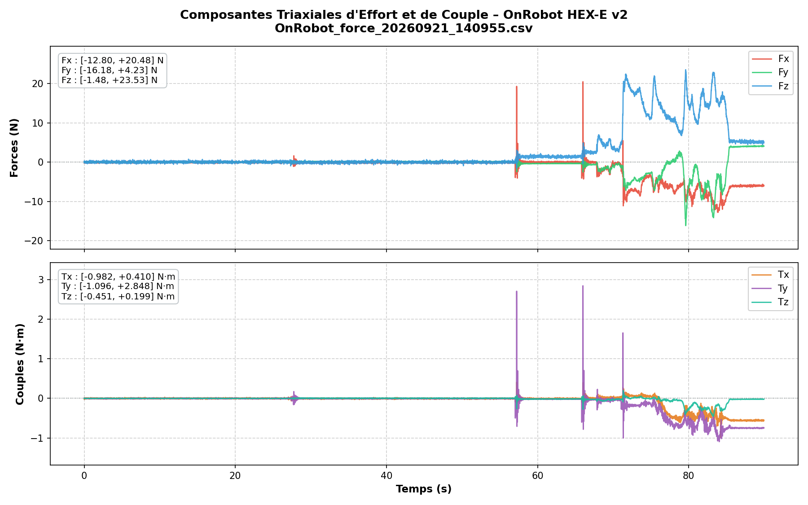 | 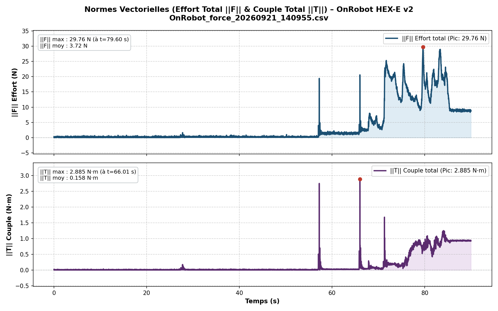 |

---

### `OnRobot_force_20260921_180517`
- **Samples:** `24714` (`248.81 s` @ `99.3 Hz`)
- **Peak Tared Force $\|\mathbf{F}\|_{\max}$:** `77.59 N` | **Peak Tared Torque $\|\mathbf{T}\|_{\max}$:** `3.212 N·m`
- **Data Files:** [`OnRobot_force_20260921_180517.csv`](./OnRobot_force_20260921_180517/OnRobot_force_20260921_180517.csv) | [`OnRobot_force_20260921_180517.npy`](./OnRobot_force_20260921_180517/OnRobot_force_20260921_180517.npy) | [`OnRobot_force_20260921_180517.txt`](./OnRobot_force_20260921_180517/OnRobot_force_20260921_180517.txt)

| Triaxial Components ($F_x, F_y, F_z$ & $T_x, T_y, T_z$) | Euclidean Norms ($\|\mathbf{F}\|$ & $\|\mathbf{T}\|$) |
| :---: | :---: |
| 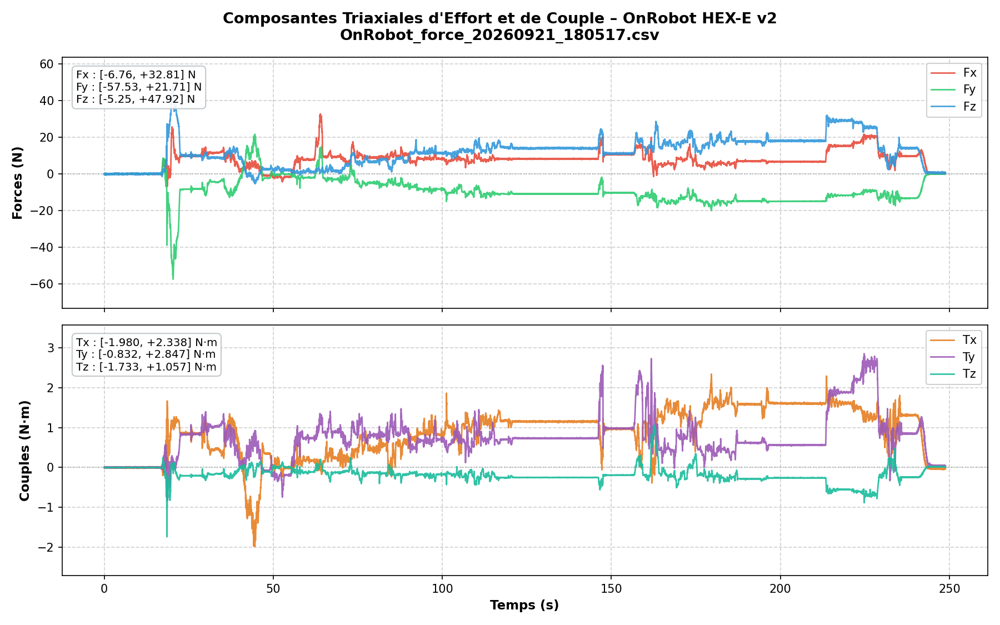 | 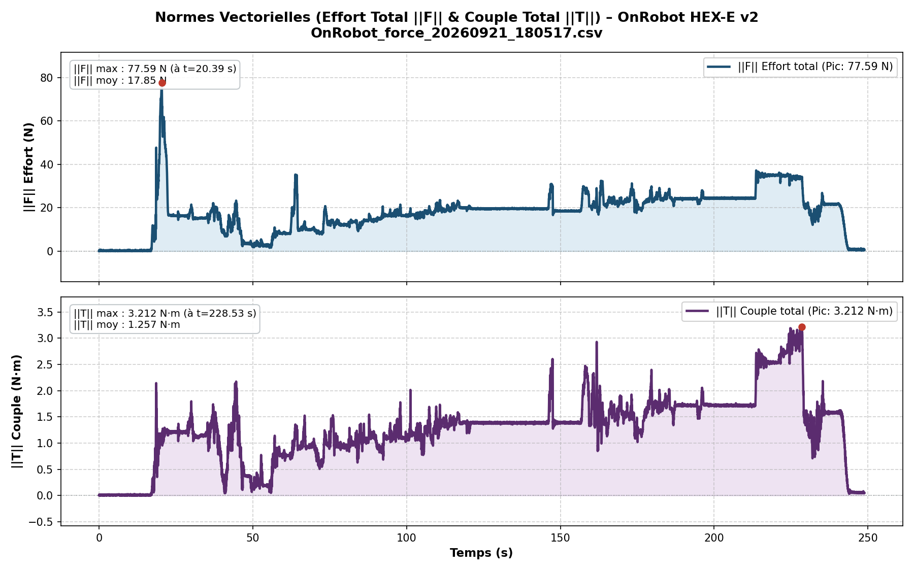 |

---

### `OnRobot_force_20260921_181159`
- **Samples:** `1952` (`19.64 s` @ `99.4 Hz`)
- **Peak Tared Force $\|\mathbf{F}\|_{\max}$:** `20.31 N` | **Peak Tared Torque $\|\mathbf{T}\|_{\max}$:** `1.584 N·m`
- **Data Files:** [`OnRobot_force_20260921_181159.csv`](./OnRobot_force_20260921_181159/OnRobot_force_20260921_181159.csv) | [`OnRobot_force_20260921_181159.npy`](./OnRobot_force_20260921_181159/OnRobot_force_20260921_181159.npy) | [`OnRobot_force_20260921_181159.txt`](./OnRobot_force_20260921_181159/OnRobot_force_20260921_181159.txt)

| Triaxial Components ($F_x, F_y, F_z$ & $T_x, T_y, T_z$) | Euclidean Norms ($\|\mathbf{F}\|$ & $\|\mathbf{T}\|$) |
| :---: | :---: |
| 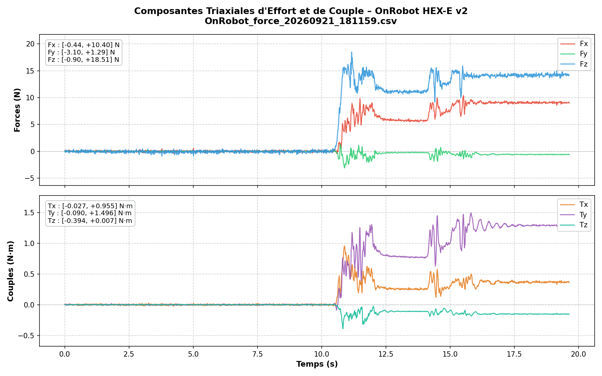 | 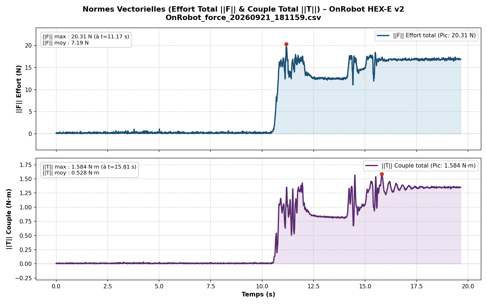 |

---

### `OnRobot_force_20260922_115607`
- **Samples:** `1708` (`17.20 s` @ `99.3 Hz`)
- **Peak Tared Force $\|\mathbf{F}\|_{\max}$:** `22.96 N` | **Peak Tared Torque $\|\mathbf{T}\|_{\max}$:** `3.094 N·m`
- **Data Files:** [`OnRobot_force_20260922_115607.csv`](./OnRobot_force_20260922_115607/OnRobot_force_20260922_115607.csv) | [`OnRobot_force_20260922_115607.npy`](./OnRobot_force_20260922_115607/OnRobot_force_20260922_115607.npy) | [`OnRobot_force_20260922_115607.txt`](./OnRobot_force_20260922_115607/OnRobot_force_20260922_115607.txt)

| Triaxial Components ($F_x, F_y, F_z$ & $T_x, T_y, T_z$) | Euclidean Norms ($\|\mathbf{F}\|$ & $\|\mathbf{T}\|$) |
| :---: | :---: |
| 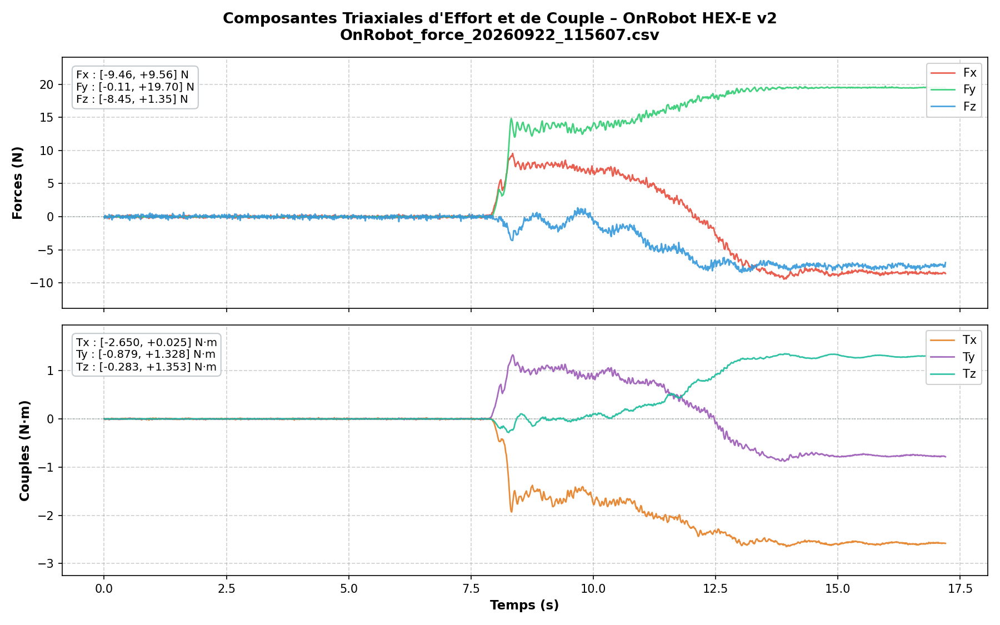 | 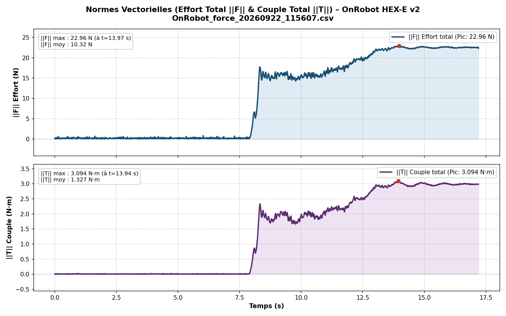 |

---

### `OnRobot_force_20260922_133715`
- **Samples:** `5757` (`57.94 s` @ `99.4 Hz`)
- **Peak Tared Force $\|\mathbf{F}\|_{\max}$:** `10.75 N` | **Peak Tared Torque $\|\mathbf{T}\|_{\max}$:** `1.279 N·m`
- **Data Files:** [`OnRobot_force_20260922_133715.csv`](./OnRobot_force_20260922_133715/OnRobot_force_20260922_133715.csv) | [`OnRobot_force_20260922_133715.npy`](./OnRobot_force_20260922_133715/OnRobot_force_20260922_133715.npy) | [`OnRobot_force_20260922_133715.txt`](./OnRobot_force_20260922_133715/OnRobot_force_20260922_133715.txt)

| Triaxial Components ($F_x, F_y, F_z$ & $T_x, T_y, T_z$) | Euclidean Norms ($\|\mathbf{F}\|$ & $\|\mathbf{T}\|$) |
| :---: | :---: |
| 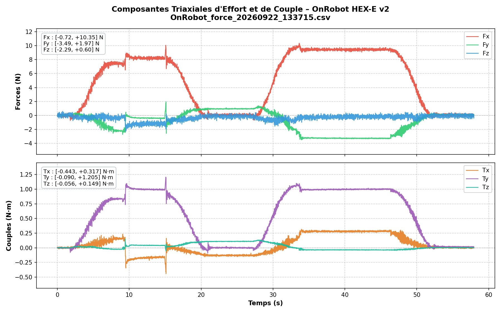 | 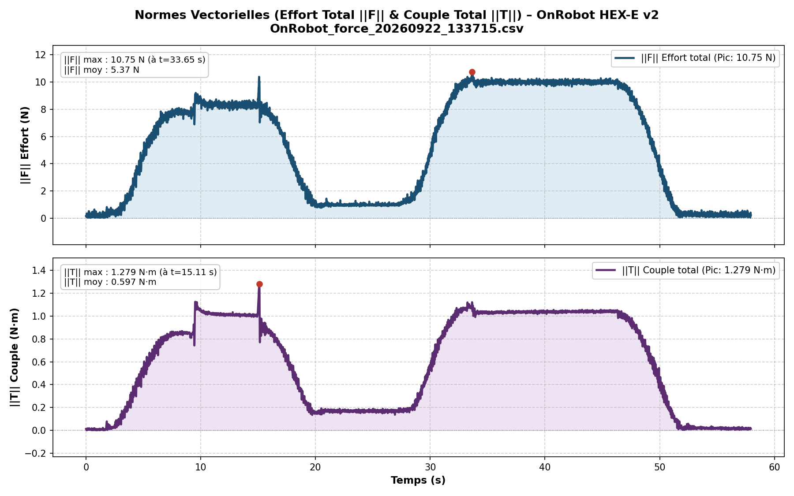 |

---

### `OnRobot_force_20260922_141008`
- **Samples:** `2035` (`20.48 s` @ `99.4 Hz`)
- **Peak Tared Force $\|\mathbf{F}\|_{\max}$:** `2.70 N` | **Peak Tared Torque $\|\mathbf{T}\|_{\max}$:** `0.359 N·m`
- **Data Files:** [`OnRobot_force_20260922_141008.csv`](./OnRobot_force_20260922_141008/OnRobot_force_20260922_141008.csv) | [`OnRobot_force_20260922_141008.npy`](./OnRobot_force_20260922_141008/OnRobot_force_20260922_141008.npy) | [`OnRobot_force_20260922_141008.txt`](./OnRobot_force_20260922_141008/OnRobot_force_20260922_141008.txt)

| Triaxial Components ($F_x, F_y, F_z$ & $T_x, T_y, T_z$) | Euclidean Norms ($\|\mathbf{F}\|$ & $\|\mathbf{T}\|$) |
| :---: | :---: |
| 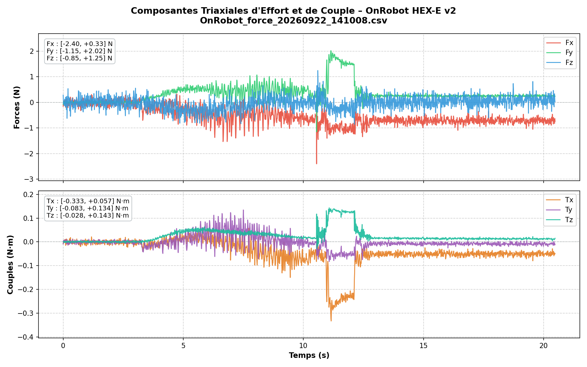 | 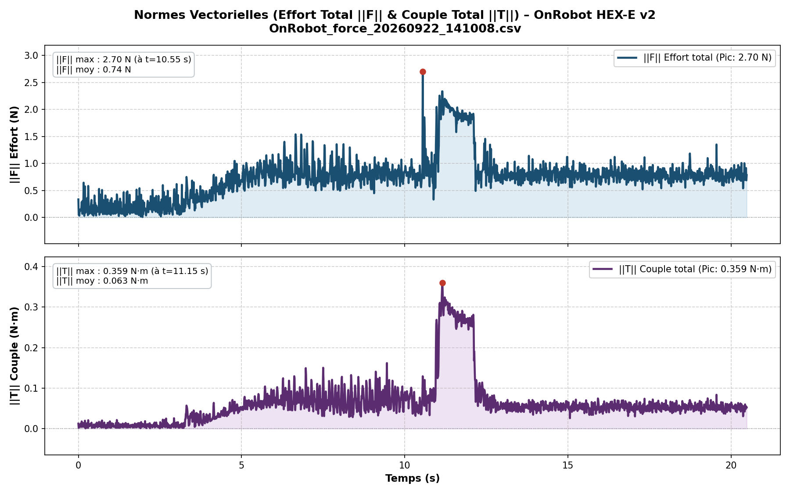 |

---

### `OnRobot_force_20260922_141532`
- **Samples:** `3785` (`38.10 s` @ `99.3 Hz`)
- **Peak Tared Force $\|\mathbf{F}\|_{\max}$:** `7.58 N` | **Peak Tared Torque $\|\mathbf{T}\|_{\max}$:** `0.819 N·m`
- **Data Files:** [`OnRobot_force_20260922_141532.csv`](./OnRobot_force_20260922_141532/OnRobot_force_20260922_141532.csv) | [`OnRobot_force_20260922_141532.npy`](./OnRobot_force_20260922_141532/OnRobot_force_20260922_141532.npy) | [`OnRobot_force_20260922_141532.txt`](./OnRobot_force_20260922_141532/OnRobot_force_20260922_141532.txt)

| Triaxial Components ($F_x, F_y, F_z$ & $T_x, T_y, T_z$) | Euclidean Norms ($\|\mathbf{F}\|$ & $\|\mathbf{T}\|$) |
| :---: | :---: |
| 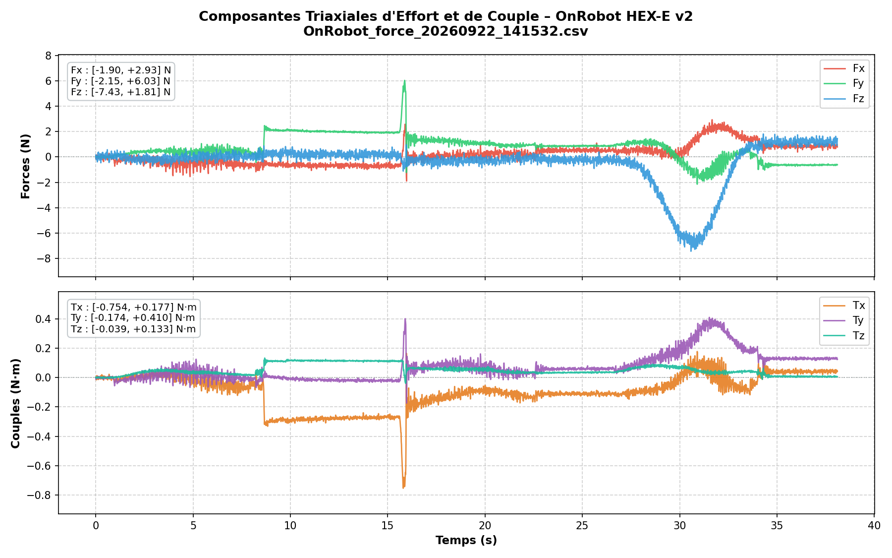 | 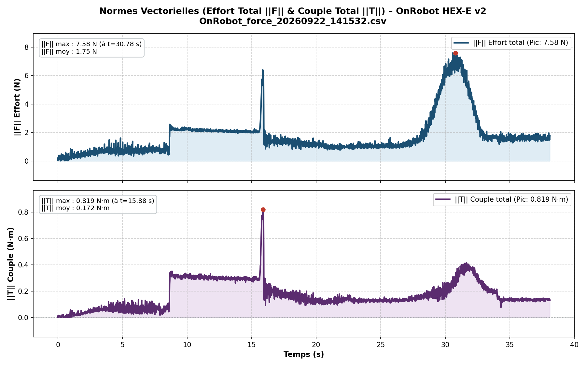 |

---

### `OnRobot_force_20260922_143515`
- **Samples:** `1580` (`15.89 s` @ `99.4 Hz`)
- **Peak Tared Force $\|\mathbf{F}\|_{\max}$:** `1.05 N` | **Peak Tared Torque $\|\mathbf{T}\|_{\max}$:** `0.035 N·m`
- **Data Files:** [`OnRobot_force_20260922_143515.csv`](./OnRobot_force_20260922_143515/OnRobot_force_20260922_143515.csv) | [`OnRobot_force_20260922_143515.npy`](./OnRobot_force_20260922_143515/OnRobot_force_20260922_143515.npy) | [`OnRobot_force_20260922_143515.txt`](./OnRobot_force_20260922_143515/OnRobot_force_20260922_143515.txt)

| Triaxial Components ($F_x, F_y, F_z$ & $T_x, T_y, T_z$) | Euclidean Norms ($\|\mathbf{F}\|$ & $\|\mathbf{T}\|$) |
| :---: | :---: |
| 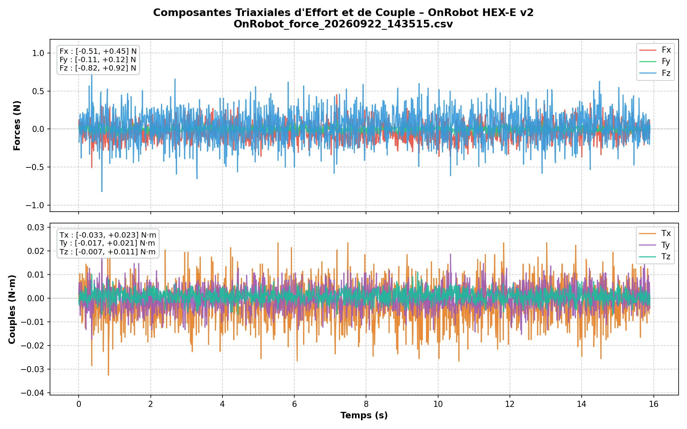 | 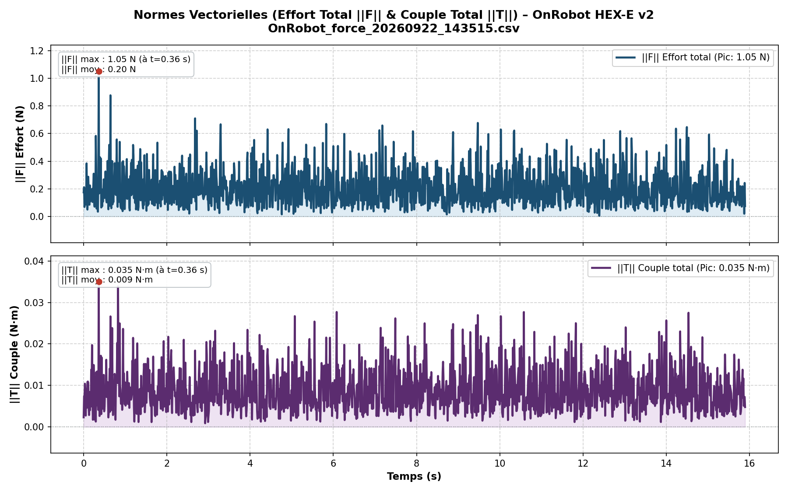 |

---

### `OnRobot_force_20260922_143902`
- **Samples:** `21089` (`212.28 s` @ `99.3 Hz`)
- **Peak Tared Force $\|\mathbf{F}\|_{\max}$:** `7.69 N` | **Peak Tared Torque $\|\mathbf{T}\|_{\max}$:** `0.686 N·m`
- **Data Files:** [`OnRobot_force_20260922_143902.csv`](./OnRobot_force_20260922_143902/OnRobot_force_20260922_143902.csv) | [`OnRobot_force_20260922_143902.npy`](./OnRobot_force_20260922_143902/OnRobot_force_20260922_143902.npy) | [`OnRobot_force_20260922_143902.txt`](./OnRobot_force_20260922_143902/OnRobot_force_20260922_143902.txt)

| Triaxial Components ($F_x, F_y, F_z$ & $T_x, T_y, T_z$) | Euclidean Norms ($\|\mathbf{F}\|$ & $\|\mathbf{T}\|$) |
| :---: | :---: |
| 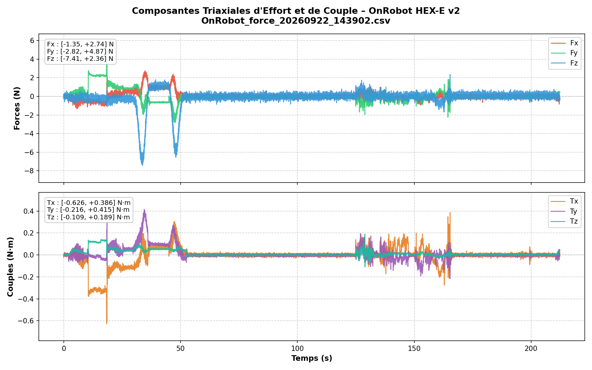 | 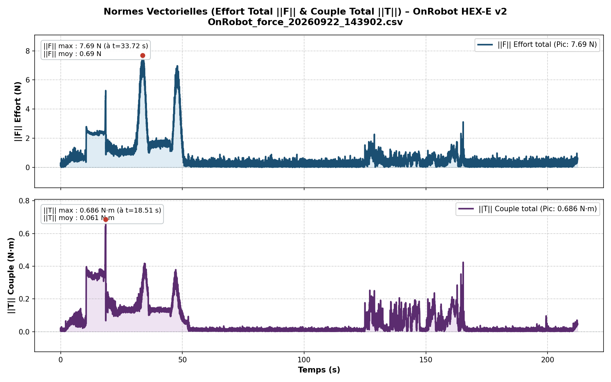 |

---

### `OnRobot_force_20260922_144631`
- **Samples:** `3447` (`34.69 s` @ `99.4 Hz`)
- **Peak Tared Force $\|\mathbf{F}\|_{\max}$:** `8.70 N` | **Peak Tared Torque $\|\mathbf{T}\|_{\max}$:** `1.139 N·m`
- **Data Files:** [`OnRobot_force_20260922_144631.csv`](./OnRobot_force_20260922_144631/OnRobot_force_20260922_144631.csv) | [`OnRobot_force_20260922_144631.npy`](./OnRobot_force_20260922_144631/OnRobot_force_20260922_144631.npy) | [`OnRobot_force_20260922_144631.txt`](./OnRobot_force_20260922_144631/OnRobot_force_20260922_144631.txt)

| Triaxial Components ($F_x, F_y, F_z$ & $T_x, T_y, T_z$) | Euclidean Norms ($\|\mathbf{F}\|$ & $\|\mathbf{T}\|$) |
| :---: | :---: |
| 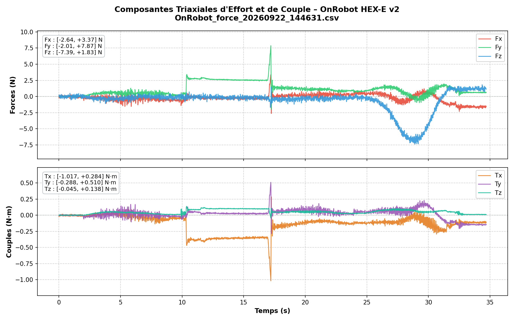 | 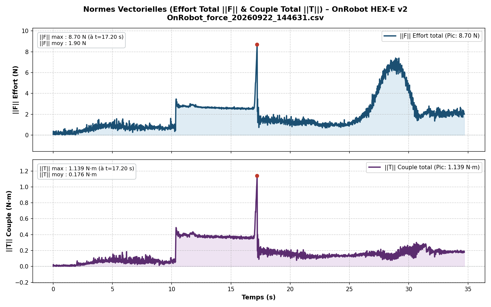 |

---

*Author: Kamil BENMADI (<kamil.benmadi@sigma-clermont.fr>) — [GitHub](https://github.com/1000K-sudo) | [LinkedIn](https://www.linkedin.com/in/kamilb-)*
