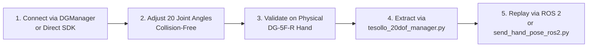

<!-- 
==============================================================================
Author: Kamil BENMADI
Email: kamil.benmadi@sigma-clermont.fr
GitHub: https://github.com/1000K-sudo
LinkedIn: https://www.linkedin.com/in/kamilb-
==============================================================================
-->

# Tesollo DG-5F 20-DoF Safe Posture Creation & ROS 2 Extraction Guide

This guide details the methodology used to design, validate, and execute **20-Degree-of-Freedom (20-DoF)** postures on the **Tesollo DG-5F** anthropomorphic hand while eliminating **inter-digital mechanical collisions**.

---

## 1. Why Full 20-DoF Control is Essential

The Tesollo DG-5F features **4 independent servo-actuated joints per finger** ($4 \times 5 = 20\text{ DoF}$):
- **Thumb (`rj_dg_1_1` .. `rj_dg_1_4`):** Abduction/Adduction, Opposition rotation, MCP flexion, IP flexion.
- **Fingers 2 to 5 — Index, Middle, Ring, Pinky (`rj_dg_2_*` .. `rj_dg_5_*`):** Lateral abduction/adduction, MCP flexion, PIP flexion, DIP flexion.

> [!WARNING]
> **Inter-Digital Collision Risk:**  
> Applying uniform flexion angles across all fingers without setting lateral abduction offsets or rotating the thumb into opposition ($\approx -90^\circ$ to $-100^\circ$) causes the fingers to converge toward the palm center and collide mechanically. Always use full 20-DoF configurations.

---

## 2. Recommended "Teach & Repeat" Workflow



---

## 3. Extracting & Capturing 20-DoF Postures

All certified 20-DoF postures are stored in [`config/hand_poses_20dof.json`](../config/hand_poses_20dof.json). Two automated extraction methods are provided by [`scripts/tesollo_20dof_manager.py`](../scripts/tesollo_20dof_manager.py):

### Method A — Import Recipes from `GripperRecipeData.json`
Synchronize operator recipes exported from DGManager into the project's 20-DoF posture catalog:
```bash
python3 scripts/tesollo_20dof_manager.py import
```

### Method B — Live Hardware Encoder Capture via `libDGSDK.so`
Capture the exact real-time 20 joint angles directly from the physical hand's encoders over Modbus TCP (`169.254.186.72:502`):
```bash
python3 scripts/tesollo_20dof_manager.py capture "MyCustomGrasp" --desc "Custom precision grasp"
```

---

## 4. Replaying Postures via CLI, Python & ROS 2

### Command-Line Execution
Use [`scripts/send_hand_pose_ros2.py`](../scripts/send_hand_pose_ros2.py) or `./ur5e_cell.sh poses` to list or execute postures with smooth temporal interpolation:

```bash
# List all certified 20-DoF postures
./ur5e_cell.sh poses --list

# Apply precision thumb-index pinch in 2.5 seconds
./ur5e_cell.sh poses DG_Pince_Fine_Pouce_Index --duration 2.5

# Return to open home posture in 1.5 seconds
./ur5e_cell.sh poses DG_Home_Ouverte --duration 1.5
```

### Python API Integration
```python
from scripts.tesollo_20dof_manager import load_20dof_presets, TesolloLowLevelSDK

presets = load_20dof_presets()
pose = presets["DG_Prise_Cylindrique_Large"]
joints_20 = pose["joints_20"]

sdk = TesolloLowLevelSDK(ip="169.254.186.72", port=502)
if sdk.connect():
    sdk.move_joint_all(joints_20, time_ms=2000)
    sdk.disconnect()
```

---

## 5. Certified 20-DoF Posture Catalog (`config/hand_poses_20dof.json`)

| Posture ID | Anatomical Configuration | Recommended Application |
| :--- | :--- | :--- |
| `DG_Home_Ouverte` | All 20 joints at $0.0^\circ$ | Home / rest posture, safe release |
| `DG_Prise_Cylindrique_Large` | Thumb opposed ($-100^\circ$), fingers spread | Grasping bottles, cylinders, boxes |
| `DG_Saisie_Enveloppante` | Curled fingers, thumb at $-95^\circ$ | Power grasp for heavy or spherical objects |
| `DG_Presaisie_Orientee` | Pre-shaped fingers, thumb at $-75^\circ$ | Pre-grasp approach prior to object contact |
| `DG_Pince_Fine_Pouce_Index` | Thumb opposed ($-90^\circ$), index flexed, others tucked | Precision pinch for small parts (screws, pens) |
| `DG_Pince_3_Doigts` | Thumb + Index + Middle active, Ring/Pinky tucked | Stable tripod grasp |

---

*Author: Kamil BENMADI (<kamil.benmadi@sigma-clermont.fr>) — [GitHub](https://github.com/1000K-sudo) | [LinkedIn](https://www.linkedin.com/in/kamilb-)*
